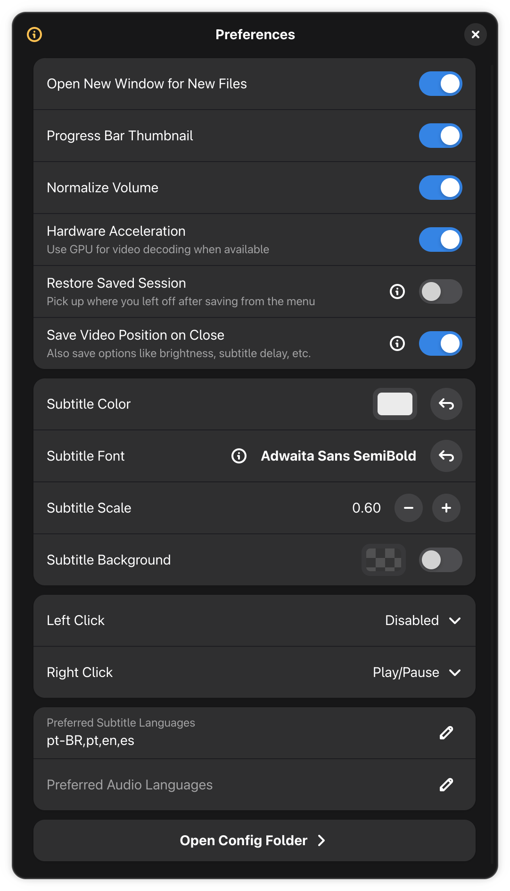
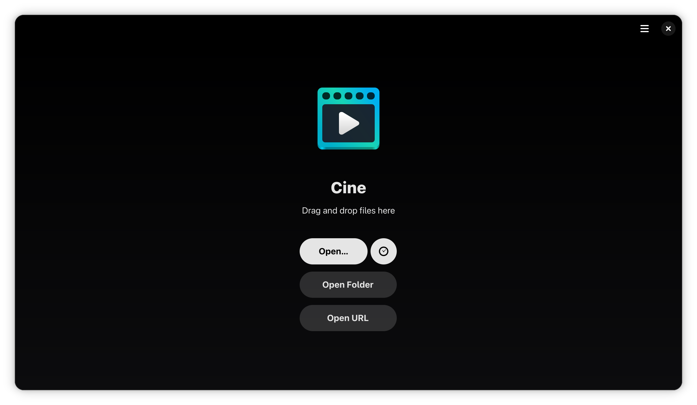

### CineHDR

Play your videos with HDR support

<br>

[-283C54?style=for-the-badge&logo=flatpak&logoColor=white)](https://github.com/rusmikev/CineHDR/releases)
[](https://github.com/rusmikev/CineHDR/actions/workflows/build-flatpak.yml)

---

### 📢 CineHDR: AI-Enhanced HDR Fork

> [!IMPORTANT]
> **Disclaimer:** This repository is an independent fork of the original [Cine](https://github.com/diegopvlk/Cine) video player. 
> The HDR implementation and UI modifications were co-developed with **Google Gemini (Advanced Agentic Coding AI)**. 
> This software is provided **"as is"**, without warranty of any kind, express or implied. Use at your own risk.
>
> **Дисклеймер:** Этот репозиторий является независимым форком оригинального видеоплеера [Cine](https://github.com/diegopvlk/Cine).
> Поддержка HDR и изменения в интерфейсе разработаны совместно с **Google Gemini (Advanced Agentic Coding AI)**.
> Программное обеспечение предоставляется **"как есть" (as is)**, без каких-либо явных или подразумеваемых гарантий.

**Changes in this fork / Изменения в этом форке:**
* Replaced standard `GtkGLArea` with a high-precision float rendering pipeline (`GL_RGBA16F` / `Rec.2100 PQ`).
* Integrated GTK4 `GdkColorState` tagging (`rec2100-pq` / `srgb` textures) and `GtkGraphicsOffload` pipeline.
* Built-in dynamic Wayland protocol probing (`wp_color_manager_v1` / `xx_color_manager_v4`) to automatically verify compositor and monitor HDR state before enabling PQ signaling.
* Added a dedicated **HDR Settings** control icon on the playback panel (visible when playing HDR content) for real-time SDR/HDR switching and peak brightness adjustment.
* Added experimental support for `libmpv`'s `gpu-next` rendering backend (`libplacebo` / Dolby Vision RPU pipeline).
* Provided system integration launcher (**CineHDR**).

**Known limitations / Известные ограничения:**
* **Wayland Color Management Pipeline**: CineHDR prepares a true 16-bit `Rec.2100 PQ` surface and communicates target color states to GTK4. Preparing or publishing a PQ texture internally is client-side state and does NOT prove physical HDR presentation on the screen. End-to-end native HDR output requires:
  1. Client-side texture publication (GDK float texture with `rec2100-pq` color state);
  2. Protocol surface submission (L3p: `wp_color_management_surface_v1.set_image_description` + `wl_surface.commit` on the video surface);
  3. Compositor presentation & physical display output (L4: visual verification on calibrated test patterns without clipping or unwanted tone-mapping).
  * **GTK 4 Color Management Configuration**: In GTK 4 (4.18–4.24.0), Wayland color management is experimental and requires `GDK_DEBUG=color-mgmt`. Without this flag, GTK disables `wp_color_manager_v1`, causing surfaces to be mapped to sRGB (falling back to high-quality SDR tone mapping via `mpv`):
    * **Flatpak (Default)**: In the installed Flatpak release (`cinehdr`), `GDK_DEBUG=color-mgmt` is enabled by default by the launcher before GTK initialization, preserving any other user-defined `GDK_DEBUG` flags. To opt out and disable automatic color management, set `CINEHDR_NO_COLOR_MGMT=1` (e.g., `flatpak run --env=CINEHDR_NO_COLOR_MGMT=1 io.github.rusmikev.CineHDR` or via `flatpak override --user --env=CINEHDR_NO_COLOR_MGMT=1 io.github.rusmikev.CineHDR`). Explicit `GDK_DEBUG=all:color-mgmt` is also respected as disabling color management.
    * **Native & Development Runs (`run_dev.py`)**: For local development runs, color management remains opt-in to avoid modifying system environment defaults: use `CINEHDR_EXPERIMENTAL_COLOR_MGMT=1`, `--experimental-color-mgmt`, or export `GDK_DEBUG=color-mgmt`.
  * **KDE Plasma (KWin)**: KWin advertises HDR capabilities (PQ, compound power 2.4) but does not advertise the `sRGB` transfer function (TF 9) in the tested protocol trace. GTK 4 requires `sRGB` to establish its baseline color space. CineHDR models GTK's policy (`gtk_cm_policy`); the intended SDR fallback still needs live KDE validation.
  * **GNOME (Mutter)**: Mutter supports client color management for `wp_color_manager_v1` including `sRGB`. On GNOME ≥ 48, HDR is toggled directly per-monitor in **Settings → Displays** (no experimental flags needed); color management in GTK is enabled by default in the Flatpak build.
* **Verified GNOME scope**: On GNOME/AMD, the legacy renderer passed HDR10 and HLG protocol submission and visual comparison with native mpv; a Dolby Vision Profile 8 clip passed as an HDR10-compatible base layer, without RPU processing. Live HDR mode, playlist, and monitor power transitions also passed on the single-monitor test setup. These observations do not establish photometric accuracy, frame-by-frame presentation, or behavior on KDE, Intel, or NVIDIA. The experimental `gpu-next` backend is outside this milestone.
* **libmpv Render Backend Selection (`render-backend`)**: CineHDR distinguishes its internal video rendering backend in `libmpv` from GTK's scene-graph renderer (`GSK_RENDERER`):
  * **Default**: `legacy` (`opengl` API) is the stable default backend.
  * **Experimental `gpu-next`**: Available via persistent preference in **Preferences → Video** and **HDR & Video Output** menu (`render-backend: gpu-next`). Changing this setting saves the choice for the next normal launch and requires an application restart; live renderer swapping in a running process is not supported. If `opengl-next` context creation fails at startup, CineHDR falls back safely to `legacy` while preserving the saved preference for subsequent runs.
  * **Developer Environment Override (`CINEHDR_RENDER_BACKEND`)**: Takes precedence over GSettings for testing:
    * `CINEHDR_RENDER_BACKEND=gpu-next`: Strict mode; fails visibly if the experimental renderer cannot be created (no creation fallback).
    * `CINEHDR_RENDER_BACKEND=auto`: Development mode with automatic fallback to `opengl` during context creation.
    * `CINEHDR_RENDER_BACKEND=legacy`: Explicit legacy OpenGL.
* **GTK Renderer Selection (`GSK_RENDERER`)**: Configures GTK's scene-graph renderer independently of the `libmpv` video backend (`legacy`/`gpu-next`). When `GSK_RENDERER` is not explicitly set by the user, CineHDR's policy (`gtk_cm_policy.apply_gsk_renderer_policy`) selects `gl` on GTK ≥ 4.18 and `ngl` on earlier GTK versions (< 4.18); under the Niri compositor (`NIRI_SOCKET` detected), it also defaults to `gl`. Any explicit user `GSK_RENDERER` environment variable is preserved as-is.
* Check **HDR Diagnostics** in the playback menu for the live pipeline state, active renderer backend, compositor capabilities, and specific fallback reasons.

---

### Verification & Platform Status / Статус проверки платформ

Testing status is recorded strictly per evidence levels defined in [docs/TESTING.md](docs/TESTING.md) (L2 = basic UI/playback integrity, L3p = Wayland protocol surface description & commit proof, L4 = visual comparison on test patterns):

| Environment / Окружение | Hardware & Stack | SDR Playback (L2) | mpv Reference (L3p) | HDR10 Protocol (L3p) | HDR10 Visual (L4) |
|---|---|---|---|---|---|
| **GNOME-AMD** | GNOME 50 / Mutter, AMD (Mesa) | **PASS** (2026-10-24) | **PASS** (2026-10-25) | **PASS** (2026-10-25; offload enabled 2026-11-02) | **PASS** (2026-10-30; visual comparison) |
| **GNOME-Intel** | GNOME ≥ 48 / Mutter, Intel (Mesa) | `NOT_RUN` | `NOT_RUN` | `NOT_RUN` | `NOT_RUN` |
| **GNOME-NVIDIA** | GNOME ≥ 48 / Mutter, NVIDIA (PRIME) | `NOT_RUN` | `NOT_RUN` | `NOT_RUN` | `NOT_RUN` |
| **KDE-AMD** | Plasma ≥ 6.7 / KWin, AMD (Mesa) | `NOT_RUN` | N/A | N/A | N/A |
| **KDE-NVIDIA** | Plasma ≥ 6.7 / KWin, NVIDIA (PRIME) | `NOT_RUN` | N/A | N/A | N/A |

> [!NOTE]
> Detailed per-scenario matrices, logs, and evidence requirements (including HLG, WCG-SDR, and runtime exit checks) are maintained in [docs/TESTING.md](docs/TESTING.md).

---

### Description

CineHDR combines a clean interface with a high-performance engine to deliver a seamless viewing experience with HDR support.

### Features

- **HDR & Color Management** — HDR content is rendered into a high-precision Rec.2100 PQ target with dynamic monitor-aware tone mapping and tri-state capability validation.
- **Renderer Selection** — Support for both stable legacy OpenGL and experimental `gpu-next` (`libplacebo`) backends with automatic safe creation fallback.
- **Simple Design** — A refined, distraction-free interface
- **MPV-Based** — Leverages the robust power of MPV for great playback and format support
- **Audio and Subtitles** — Control track selection and synchronization for both
- **Video Controls** — Easily adjust brightness, contrast, zoom, aspect ratio, etc.

### Screenshot

<p align="center"></p>

<div>
  <details>
    <summary>More Screenshots (Expand):</summary><br>
      <p align="center"></p>
      <p align="center"></p>
      <p align="center"></p>
  </details>
</div>

### Donate (Upstream Project)

If you want to support the original creator of Cine (Diego Povliuk), you can use:

- [PayPal](https://www.paypal.com/donate?hosted_button_id=DVL7H35GA66X6)
- [Ko-fi](https://ko-fi.com/diegopvlk)
- Pix: diego.pvlk@gmail.com

### Translations (Upstream Project)

You can help translate upstream Cine using [Weblate](https://hosted.weblate.org/projects/cine/app/).
Strings specific to this fork (the HDR menu and diagnostics) are not on Weblate — translation contributions for them are welcome as pull requests against `po/`.

[](https://hosted.weblate.org/engage/cine/)


### Code of Conduct

This project follows the [GNOME Code of Conduct](https://conduct.gnome.org).

### Installation / Установка

For general users, the easiest way to install **CineHDR** is using Flatpak:

#### Option A: Pre-built Flatpak (Fastest) / Готовая сборка Flatpak
1. Open the [GitHub Releases](https://github.com/rusmikev/CineHDR/releases) page and choose the desired release (including prereleases, when appropriate).
2. Download its `CineHDR-x86_64.flatpak` asset.
3. Install it by running the following command in your terminal:
   ```bash
   flatpak install --user CineHDR-x86_64.flatpak
   ```

#### Option B: Build Flatpak from source / Сборка Flatpak из исходников
If you want to compile the Flatpak bundle yourself:
1. Ensure `flatpak` and `flatpak-builder` are installed on your system.
2. Add the Flathub repository (required for runtime dependencies):
   ```bash
   flatpak remote-add --user --if-not-exists flathub https://dl.flathub.org/repo/flathub.flatpakrepo
   ```
3. Build and install the application:
   ```bash
   flatpak-builder --user --install --force-clean build-dir build-aux/flatpak/io.github.rusmikev.CineHDR.json
   ```

#### Option C: Native compilation / Локальная сборка
1. Install development dependencies (`meson`, `ninja`, `python3-mpv`, and dependencies for GTK4/Adwaita).
2. Clone the repo, open it in GNOME Builder and press run, or compile it manually using:
   ```bash
   meson setup build
   meson compile -C build
   ```
