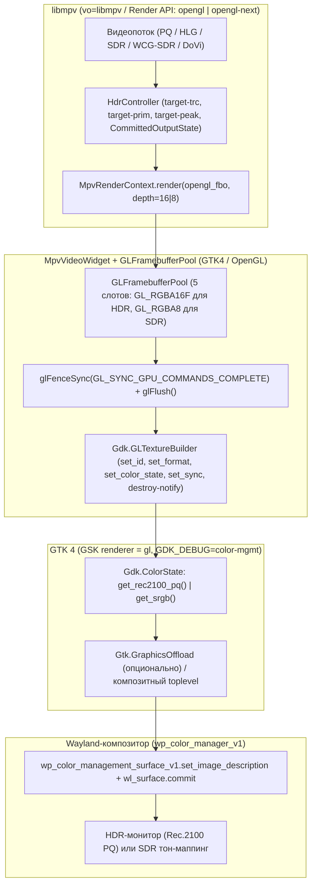

# Архитектура конвейера CineHDR

Документ описывает сквозной конвейер рендеринга и управления цветом в CineHDR,
распределение инвариантов `AGENTS.md` (§3, §4, §5, §9) по модулям и точки
подключения инструментов валидации.

---

## 1. Сквозной конвейер рендеринга

---

## 2. Детекция, гейт `auto` и принятие решения (`CommittedOutputState`)

Решение о включении HDR-вывода принимается в `HdrController` на основании
фактов из `hdr_detection.py`, `gtk_cm_policy.py`, `wayland_cm_probe.py` и
`wayland_output_hdr.py` и фиксируется в неизменяемом снимке
`CommittedOutputState(epoch, is_hdr, is_float, fbo_format, gdk_color_state, target_trc, target_prim, target_peak)`:

1. **Защита от Dolby Vision Profile 5 (`DOVI_UNSUPPORTED_PROFILES = (5,)`):**
   проверяется **до** пользовательского режима `hdr-mode`. Профиль 5 использует
   собственное пространство `IPTPQc2`; без сертифицированного RPU reshaping
   разметка текстуры как `Rec.2100 PQ` даёт зелёно-пурпурные цвета и переводит
   монитор в HDR. Поэтому Profile 5 принудительно остаётся в SDR даже при
   `force-hdr`. Profile 8 с HDR10-совместимым базовым слоем проходит по базовому
   PQ-слою.
2. **Пользовательский режим (`hdr-mode`):**
   - `force-sdr` → всегда SDR (`GL_RGBA8`, `Gdk.ColorState.get_srgb()`, `target-trc=auto`, `target-prim=auto`, `target-peak=auto`);
   - `force-hdr` → при наличии базовой системной поддержки (`check_hdr_support()`) принудительно включает HDR-конвейер (используется пользователем осознанно, а также в L3p-проверках);
   - `auto` → требует одновременного выполнения:
     - **критерия контента (`is_hdr_content` в `hdr_detection.py`, `AGENTS.md` §5.4):** трансфер потока `gamma ∈ {"pq", "hlg"}`. Широкий охват (`primaries=bt.2020` на трансфере `bt.1886`/`srgb`, т.е. WCG-SDR) и метаданные `sig-peak > 1.0` сами по себе HDR **не включают**;
     - **гейта качества вывода (`hdr_output_allowed` / `evaluate_hdr_gate`, ADR-0007 / ADR-0008):**
       1. Композитор объявляет глобал `wp_color_manager_v1` (`wayland_cm_probe.py`);
       2. Включён opt-in GTK `GDK_DEBUG=color-mgmt` до `Gtk.init()` и не задан `CINEHDR_NO_COLOR_MGMT=1` (`gtk_cm_policy.py`);
       3. Возможности композитора (`CmCaps` из `wayland_output_hdr.py`) удовлетворяют требованиям GTK (`gtk_color_managed`: `INTENT_PERCEPTUAL`, `FEAT_PARAMETRIC`, `TF_SRGB`, `PRIM_SRGB` или `FEAT_SET_PRIMARIES`) и позволяют тегировать HDR (`gtk_can_tag_hdr`: `PRIM_BT2020` + `TF_PQ`);
       4. Монитор, на котором находится окно (`connector` из `Gdk.Display.get_monitor_at_surface`), находится в режиме HDR (`classify_hdr`: `st2084_pq`/`hlg` либо `max_lum > reference_lum`). При нескольких мониторах и неизвестном коннекторе гейт закрыт (fail-closed).

---

## 3. Ключевые архитектурные инварианты и где они живут

| Инвариант (`AGENTS.md`) | Модуль и механизм |
|---|---|
| **§4.1 Пул текстур и `destroy-notify`** | `src/gl_renderer.py` (`GLFramebufferPool`, 5 слотов) + `src/video_widget.py`. Текстура, переданная в `Gdk.GLTextureBuilder.build(destroy=..., data=...)`, помечается `in_use` и возвращается в пул только из `destroy-notify` GTK. `glFenceSync` + `glFlush()` + `builder.set_sync(fence)` синхронизируют GPU-команды между контекстом GLArea и рендерером GSK, но не заменяют владение слотом пула. |
| **§4.2 Чистый `do_snapshot`** | `src/video_widget.py:do_snapshot`. Выполняет только `snapshot.append_texture(self.current_texture, rect)`. Рендер кадра mpv и GL-вызовы происходят исключительно в idle-обработчике `_render_pending_frame`, планируемом из `mpv_ctx.update_cb`. |
| **§4.3 Горячий путь без системных запросов** | `src/video_widget.py:_render_pending_frame`. Не вызывает `check_hdr_support()`, Wayland roundtrip или чтение свойств mpv (кроме `mpv_ctx.update()` и однократного `media_frame_evidence` до первого медиа-кадра). Использует атомарный снимок `hdr_controller.committed_output_state` и кэшированные при `realize`/`size-allocate`/`enter-monitor` масштаб и габариты монитора. |
| **§4.5 Порядок завершения libmpv** | `src/window.py` (`do_close_request`) → `src/video_widget.py` (`shutdown_render_context`). Строгий порядок: отключение `update_cb` → `area.make_current()` → `mpv_ctx.free()` → `fbo_pool.release_all()` → `mpv.quit()` / `wait_for_shutdown()`. |
| **§4.6 Неизменяемость backend на сессию** | `src/render_backend.py` (`ProcessRenderSelection`). Выбор `legacy` (`opengl`) или `gpu-next` (`opengl-next`) фиксируется один раз при старте процесса; fallback с `gpu-next` на `legacy` разрешён только при первичном создании контекста в `_on_realize`. |
| **§5.2, ADR-0007 Републикация на паузе и эпохи** | `src/hdr_controller.py` + `src/video_widget.py`. Каждое изменение целевого состояния вывода увеличивает `CommittedOutputState.epoch`. Во время переконфигурации свойств mpv (`is_publication_pending`) публикация промежуточных кадров подавляется; после коммита новой эпохи виджет вызывает `_schedule_render(force_redraw=True)`, чтобы перерисовать даже поставленный на паузу кадр в новый формат FBO (`GL_RGBA16F` ↔ `GL_RGBA8`) и новый `Gdk.ColorState`. |
| **Фиксация `target-prim=bt.2020` и конвертация HLG → PQ** | `src/hdr_controller.py:apply_hdr_settings`. В режиме HDR текстура всегда помечается `Gdk.ColorState.get_rec2100_pq()` (BT.2020 + ST.2084 PQ). Поэтому для любого HDR-потока (как HDR10, так и HLG) в mpv устанавливаются `target-prim=bt.2020` и `target-trc=pq` (mpv преобразует HLG в PQ до записи в `GL_RGBA16F` FBO). |
| **Политика `target-peak` (P1.6 / ADR-0007)** | `src/hdr_controller.py`. По умолчанию в `Auto` передаётся `target-peak=auto` (pass-through без клиентского клиппинга под угаданный пик); ручные пресеты (например, `400`, `600`, `1000` нит) применяются явно по выбору пользователя. |
| **Политика `GSK_RENDERER` и `GDK_DEBUG`** | `src/gtk_cm_policy.py`. Лаунчеры вызывают `apply_color_mgmt_opt_in` и `apply_gsk_renderer_policy` **до** импорта `gi.repository.Gtk`. На GTK ≥ 4.18 выбирается `GSK_RENDERER=gl` (современный NGL-рендерер, поддерживающий `Gdk.ColorState` и `R16G16B16A16_FLOAT` и разделяющий GL-контекст с `Gtk.GLArea` без дорогостоящего импорта текстур в Vulkan). |
| **Ограничение GTK + KWin ≥ 6.7 (D8)** | `src/gtk_cm_policy.py:gtk_color_managed`. В `gdk/wayland/gdkwaylandcolor.c` (GTK 4.22.5 и 4.24.1) `gdk_wayland_color_prepare` требует `TF_SRGB` (9) и при его отсутствии уничтожает `wp_color_manager_v1`. KWin с Plasma 6.7 не объявляет `TF_SRGB` (deprecated в `color-management-v1` v2 в пользу `gamma22`). `gtk_color_managed()` точно отражает это условие и закрывает гейт `auto` с причиной `"GTK cannot create sRGB image description: missing TF srgb"`. |
| **Совместимость `python-mpv 1.0.8` (`depth`)** | `src/render_backend.py:install_python_mpv_depth_compat`. Пиннованный `python-mpv 1.0.8` содержит баг в `MpvRenderParam.__init__`: целочисленный параметр `MPV_RENDER_PARAM_DEPTH` (`(5, int)`) вызывается как `int(**value)` и падает с `TypeError`. Шим точечно исправляет конструктор для `name == "depth"` при инициализации контекста и обязателен, пока используется `python-mpv 1.0.8`. |
| **Общий `wl_display` у GTK и пробников Wayland** | `src/wayland_cm_probe.py:_get_wl_display_ptr`, `src/wayland_output_hdr.py`. Оба модуля **уже не открывают нового соединения**: они получают существующий указатель `wl_display*` GTK через `utils.get_display_param()` (`gdk_wayland_display_get_wl_display`) и создают на нём изолированную очередь `wl_event_queue` с `wl_proxy_create_wrapper`. Дополнительные соединения `wl_display` в `WAYLAND_DEBUG=1` создаются не пробниками CineHDR, а внутренними подсистемами Mesa (EGL / Vulkan WSI / `libva-wayland`) и `libmpv` — именно для отделения соединения GTK (`conn#1`) от соединений драйвера/mpv в режиме `--trace-only` используется `tools/validation/wayland_conn_tagger.c`. |
| **§9 Единственный сборщик диагностики** | `src/diagnostics_report.py` (`collect_video_output_facts`, `build_video_output_report`). Используется и окном `HDR Diagnostics` (`src/hdr_diagnostics.py`), и кнопкой `Copy Report`, и валидационным автоэкспортом. |

---

## 4. Точки подключения измерений в продукте (`AGENTS.md` §9, `PLAN` C4c)

Чтобы инструменты из `tools/validation/` могли проверять реальный FBO и
состояние конвейера в момент публикации кадра, не попадая в устанавливаемый
продукт, в продуктовом коде сохраняются минимальные пассивные точки подключения
(по умолчанию `None`/выключены, при `None` не выполняют работы и не импортируют
валидационные модули).

Точная карта вхождений на `7d3f3b1` (`grep -n "_fbo_pixel_oracle\|_media_load_generation\|on_first_media_frame_published" src/*.py`):

| Точка подключения | Файл и строки (`7d3f3b1`) | Назначение |
|---|---|---|
| `_fbo_pixel_oracle_cb`, `_fbo_pixel_oracle_error_cb` (+ `_fbo_pixel_oracle_sampler` в C4 шаг 1) | `src/video_widget.py:139-140` (объявление `None`), `src/video_widget.py:659-671` (сэмплирование того же `slot.resource.fbo_id` сразу после `mpv_ctx.render`), `src/video_widget.py:852-871` (передача `slot`, `epoch`, `frame_generation`, `fbo_format`, `is_float`, `width`, `height`, `patch_samples` после сборки `Gdk.Texture`); установка/снятие в валидаторе: `src/gpu_validation.py:1646-1649, 3279-3282` | Измерение пикселей FBO в момент публикации кадра для `PausedTransitionPixelOracle` (режим `publication`). |
| `on_first_media_frame_published` | `src/video_widget.py:881-887` (вызов через `idle_add_once` при публикации первого декодированного медиа-кадра с `media_frame_evidence`), `src/window.py:1748` (обработчик в окне) | Автоснятие диагностического снимка и фиксация состояния конвейера именно на первом опубликованном медиа-кадре. |
| `_media_load_generation` | `src/window.py:238` (инициализация `0`), `src/window.py:1917` (инкремент при загрузке медиа), `src/window.py:1762, 1816`, `src/video_widget.py:687`, `src/diagnostics_report.py:1053, 1073` | Отслеживание поколения загрузки медиа в паре `(render_context_generation, _media_load_generation)`, чтобы первокадровый снимок срабатывал ровно один раз на каждое загруженное видео. |
| `CommittedOutputState.epoch` | `src/hdr_controller.py` → `src/video_widget.py:138, 236, 619, 761-764, 848, 858` | Сопоставление каждого опубликованного FBO-кадра с зафиксированной эпохой целевого состояния (`SDR → HDR → SDR` на паузе) и отбраковка устаревших кадров (`superseded`). |
